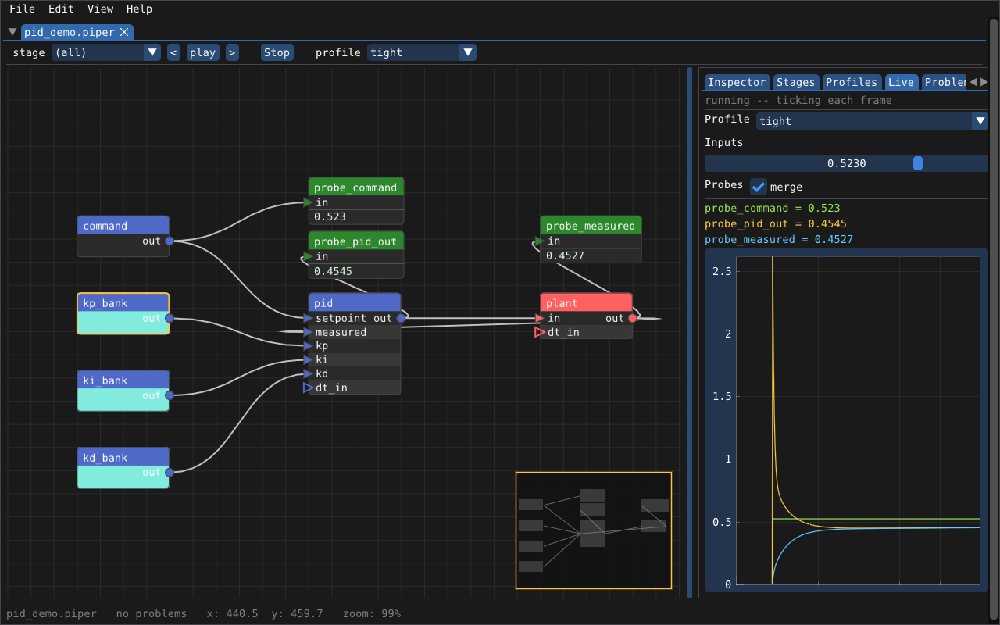

# Introduction

Piper is a visual editor and runtime for control-system pipelines. Wire typed
nodes on the canvas, configure them with profiles, and run a pipeline in the
editor or from your own program.

The bundled PID demo gives you a working feedback loop to explore. In this tutorial,
you'll run it, change a profile, and see how the simulated plant responds.

## Build the Piper editor

Building the editor requires a C++20 toolchain, CMake 3.28 or later, Conan 2.10
or later, and the GLFW development dependencies for your platform. Run the
following commands from the repository root.

```bash
./setup_build.sh build
cmake -S . -B build
cmake --build build --target piper_editor --parallel
```

## Open the PID demo

From the repository root, open the demo in the editor you just built.

```bash
./build/app/piper-editor examples/pid_demo/pid_demo.piper
```

## Run the engine

1. Click **Run** in the toolbar to open the **Live** panel.
2. Under **Inputs**, drag the `command` slider from zero to a positive value.
   You can also **Ctrl+click** the slider and enter `0.5`. Watch `probe_measured`
   converge to `probe_command`.
3. You've now run your first pipeline - but what if you want to tweak the PID's response?
   That's what **Profiles** are for: in this demo, various profiles implement different gains.
   Select `loose` from the **Profile** dropdown in **Live**, then change `command` again by
   about the same amount. You'll notice a response slower than before.



Continue to [Key concepts](key_concepts.md) to see how the graph
produces that response, then [work in the editor](editor.md) to change the
configuration yourself.
