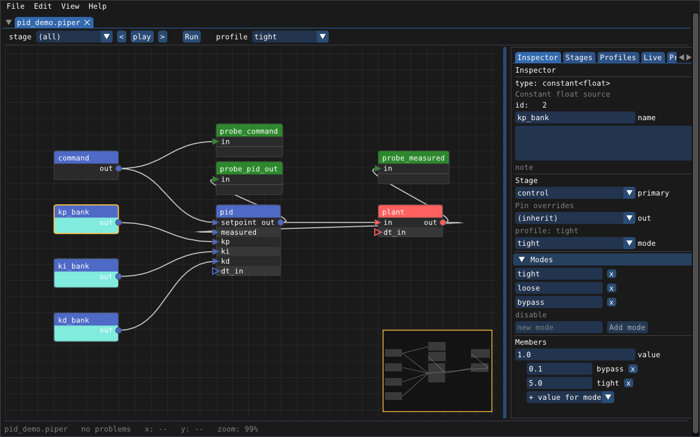

# Key concepts

Keep the [PID demo](index.md#open-the-pid-demo) open as you read.

In this pipeline, `command` supplies a target value. The `pid` controller
compares that target with the measured output of the simulated `plant`, then
uses the difference to decide how to drive the plant toward the target.

## From the canvas to a running pipeline

A **pipeline** is a graph made up of nodes and the links between them. Piper
saves the graph and its settings in a `.piper` JSON file. You edit the graph
in the Piper editor. When you click **Run**, the engine uses that graph to
create and connect the steps that will run. A host program can also load and
run a saved pipeline, without needing any GUI.

A **node** is one box in the graph. It represents one operation, such as
producing a fixed value or computing a controller output. A **node type**
describes how to configure nodes of that kind. In the demo, `kp_bank`,
`ki_bank`, and `kd_bank` are three nodes of type `constant<float>`. Each
has its own settings and connections and supplies a different PID gain.

The node type describes what you can wire and configure on its nodes.

- **Pins** are the inputs and outputs you wire on the canvas. A
  `constant<float>` has one output pin, `out`, which carries a floating-point
  value.
- **Members** are settings you edit in the Inspector. The constant node has
  a `value` member that sets the number it supplies.
- **External I/O** lets the program running the pipeline write inputs or
  read outputs by name. When a node exposes external I/O, you can edit its
  **External name** in the Inspector.
- **Modes** are named choices for a node. The type can declare an initial
  set of modes. If it declares none, the node starts with `enable`. You can
  add modes to individual nodes, as the demo does for the three gain banks.

A **step** is the runtime object behind a node. The engine uses the node's
type to find the appropriate step implementation. The step uses that node's
settings and connections. For `kp_bank`, the constant step publishes the
configured `value` on `out`, where the controller can read it.

## How values move through the graph

A **link** connects an output pin to a compatible input pin. For example,
the `out` pin on `kp_bank` is linked to the `kp` input on `pid`. That link
lets the controller read the gain supplied by the constant step.

In the demo, the editor's Live panel writes the named external input
`command`. The `command` node supplies that value to the controller through a
link. At the other end, the `probe_measured` node receives the plant output
through a link and exposes it as a named external output that Live can plot.

## When steps run

A **tick** is one pass through the pipeline. A **stage** groups steps into a
named part of that pass. The engine runs stages in the order listed in the
editor's **Stages** tab. Within a stage, links let the engine order producers
before the steps that read their outputs.

In the PID demo, `control` runs first and computes a new controller output.
The `plant` stage then uses that output to update the simulated plant.
The `probe` stage runs last to collect the signals for display. Since the
controller runs before the plant, it uses the plant output from the previous
tick. That one-tick delay is what lets the feedback loop run.

## How profiles change the running pipeline

A **profile** is a named configuration for the whole pipeline. It selects
one mode for each node. A node's members each have a default value and can
have an **override** for a particular mode. When a profile selects that
mode, the step receives the override for any member that has one and the
default for the other members.

For example, switching profiles changes the gain that `kp_bank` supplies to
`pid`. The same link carries the new value.

| Active profile | Mode selected on `kp_bank` | Effective `value` |
| --- | --- | --- |
| `loose` | `loose` | `1.0` from the member default |
| `tight` | `tight` | `5.0` from the `tight` override |

The demo uses matching profile and mode names for its gain banks. You can
also mix modes within a profile. For example, the `loose` profile can select
`tight` for `kp_bank` while still selecting `loose` for `ki_bank` and `kd_bank`.

Each step decides whether the selected mode changes how it runs. The engine
handles the reserved `disable` mode for every node by skipping its step.

Next, [change a member override and add a probe](editor.md).
